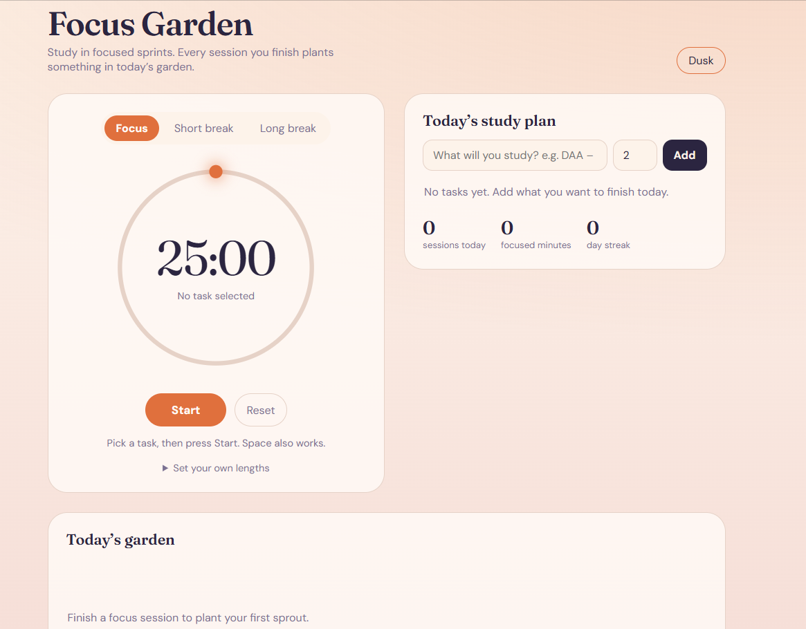
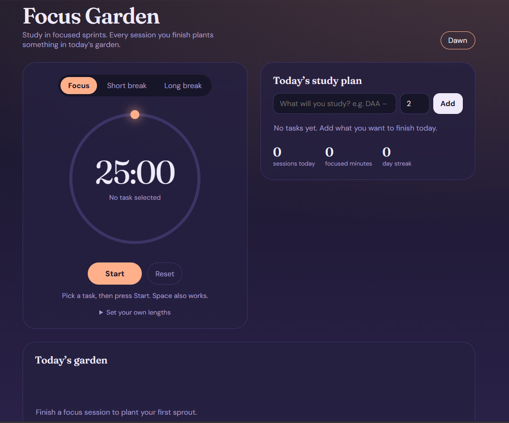

# Focus Garden: Pomodoro + Study Planner

A study tool that turns focus time into a growing garden. Plan your day with tasks, run Pomodoro sessions on a visual sun-dial timer, and watch a plant grow for every session you finish.

## Features
- Pomodoro timer with Focus, Short break and Long break modes (long break after every 4 sessions)
- Sun-dial progress ring built with SVG
- Study planner: add tasks with planned sessions, pick one, and track progress with dots
- Garden: one plant per completed session, a flower blooms on every 4th
- Daily stats: sessions, focused minutes, day streak
- Custom timer lengths, Dusk/Dawn (dark/light) theme
- Keyboard shortcut: Space to start or pause
- Data saved in the browser (localStorage)

## Tech stack
HTML, CSS, JavaScript (no frameworks), SVG, Web Audio API, localStorage

## Run locally
Open `index.html` in any browser. No install or build step needed.

## What I learned
- Timestamp-based countdown (`endAt - Date.now()`) stays accurate even when the tab is in the background
- Drawing progress with SVG `stroke-dashoffset` and positioning the sun with `cos` and `sin`
- Managing app state in one object and persisting it with localStorage
- Theming with CSS variables

## Screenshot

